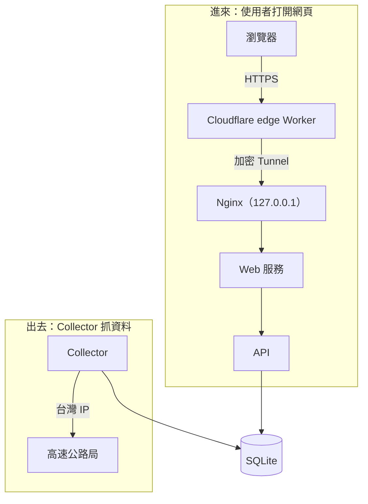

# 03 一個請求怎麼走

[← 02 為什麼是台灣 VPS](02-why-taiwan-vps.md) · [目錄](README.md) · [04 活著不等於能用 →](04-alive-is-not-ready.md)

## 主機上有兩條方向相反的路

入隧前的主機上同時有兩種流量：

- **進來**：使用者打開網頁，請求從外面一路送進主機。
- **出去**：主機上的 Collector 主動連到高速公路局，把官方資料抓回來。

兩條路在 SQLite 資料庫交會：Collector 寫進去，API 讀出來。使用者從頭到尾都不會直接碰到高速公路局。

## 主機的大門是鎖著的，請求怎麼進來？

主機上的 Nginx、Web 服務、API 都只綁在 `127.0.0.1`。這個位址的意思是「這台主機自己」，只有同一台主機上的程式連得到。

它不是在檢查「你是誰」，而是限制「從哪裡撥得到」。可以想成家裡的內線分機：外面的人不是被擋下來，而是根本撥不到內線號碼。主機的公開 IP 也沒有開放 80／443 port，等於大門鎖上。

使用者的請求能進來，是因為 **Tunnel 由主機主動往外連**：

1. 主機上的 Tunnel 程式先主動連到 Cloudflare，建立一條加密通道，並保持連線。
2. 使用者的請求先到 Cloudflare。
3. Cloudflare 把請求順著這條通道送回主機。
4. Tunnel 程式在主機內部，把請求轉交給 `127.0.0.1` 上的 Nginx。

一般防火牆擋的是「外面主動連進來」，通常不擋「裡面主動連出去」。Tunnel 利用這一點，讓主機不用開任何對外的門，也能提供服務。

## 台灣 IP 在出去的那條路上起作用

Collector 連到高速公路局時，對方收到的封包上寫著寄件人地址，也就是來源 IP，這就是這台台灣 VPS 的 IP。來源 IP 屬於 **L3 網路層**。

使用者不管在哪裡，都只連到 Cloudflare。真正去抓資料的永遠是台灣這台主機，所以使用者的位置不影響資料收集。這就是第 02 章把資料收集放在台灣 VPS 的原因。

## JS 檔和 API：同一個任務的兩個步驟

打開入隧前時，瀏覽器其實要了兩種東西：

1. **網頁程式**：HTML 是骨架，CSS 是外觀，JS 是會動的程式。
2. **路況資料**：JS 在手機上跑起來後，向 API 要現在的路況，拿到後依自己的邏輯畫成畫面。

兩者合起來才能「讓使用者看到現在的路況」，只是分工不同：JS 負責顯示，API 負責提供資料。

Cloudflare 對兩者的處理也不同，差別在**內容會不會變**：

| | 版本化的 JS／CSS 檔 | API 請求 |
|---|---|---|
| 內容會變嗎 | 不會。程式改版時，檔名裡由內容算出的 hash 會跟著換，變成新檔名 | 一直在變，主機每 10 秒重建一次資料 |
| Cloudflare 怎麼做 | 先查快取，有就直接回，沒有才回主機拿 | 不快取，每次都經 Tunnel 回主機拿 |
| 快取時間 | 瀏覽器一年、Cloudflare 一天 | 不保存（`no-store`） |

API 不是「沒辦法」快取，而是**刻意不快取**。路況資料一舊就是錯的，存起來重複給，會違反第 01 章「資料過期就不給建議」的原則。

每個請求在分流之前，都會先通過同一套安全檢查：只接受 HTTPS、拒絕管理路徑、API 只放行白名單。

## 對到網路分層

| 層 | 進來的路 | 出去的路 |
|---|---|---|
| L7 應用層 | HTTP 請求、Worker 安全檢查、Nginx 轉送、API | 抓 XML／JSON |
| L7（DNS） | 查 Cloudflare 的網域 | 查高速公路局的網域 |
| TLS（常歸在 L5／L6） | 瀏覽器到 Cloudflare 的 HTTPS 加密 | 連官方網站的 HTTPS |
| L4 傳輸層 | 主機內部各服務使用的 port | 連到對方的 443 port |
| L3 網路層 | `127.0.0.1` 只有本機連得到；公開 IP 不開 port | 台灣 IP：對方依來源 IP 判斷你從哪裡來 |

OSI 七層是教學用的模型，實際對應不一定剛好。這張表是我理解這個系統的方式，不是精確的協定分析。

---

查核依據：私人 repo `README.md`、`deploy/https-edge/README.md`、`deploy/nginx/` 與 `deploy/network/` 的設定（2026-10-21，dev `a30d531`）。本章依設定檔整理，不是在主機上實際觀察的結果。
