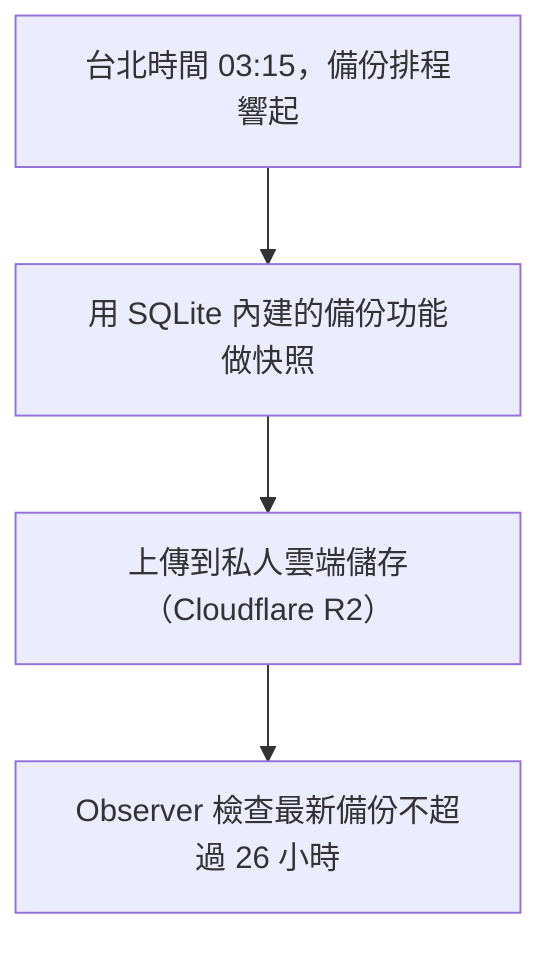

# 05 服務怎麼被管理

[← 04 活著不等於能用](04-alive-is-not-ready.md) · [目錄](README.md) · [06 開發筆記 →](06-dev-notes.md)

主機上的程式誰負責啟動？掛了誰救？備份什麼時候做？log 會不會塞滿硬碟？答案大多是同一個：Linux 的服務總管 **systemd**。

## systemd 管了哪些東西

systemd 管的東西分兩種：

- **服務（service）**：一直在跑的程式。
- **排程（timer）**：時間到了才跑一次，像鬧鐘。

| 名稱 | 種類 | 做什麼 |
|---|---|---|
| `snow-sentinel-web` | 服務 | 提供網頁 |
| `snow-sentinel-api` | 服務 | 回應路況查詢 |
| `snow-sentinel-collector` | 服務 | 抓官方資料、寫進 SQLite |
| `nginx` | 服務 | 接住 Tunnel 送進來的請求，轉給 Web |
| `snow-sentinel-observe.timer` | 排程 | 每分鐘執行一次 Observer（第 04 章） |
| `snow-sentinel-backup.timer` | 排程 | 每天台北時間 03:15 備份資料庫 |

名稱裡的 `snow-sentinel` 是專案改名前的舊名。

## 看懂一份服務設定

每個服務都有一份設定檔（unit file）。以 API 為例，節錄如下：

```ini
[Unit]
After=network-online.target

[Service]
User=snow-sentinel
WorkingDirectory=/srv/snow-tunnel-sentinel/current
EnvironmentFile=/etc/snow-tunnel-sentinel/runtime.env
ExecStart=/usr/local/bin/node --import tsx apps/api/server.ts
Restart=on-failure
RestartSec=5s
ProtectSystem=strict
ReadWritePaths=/var/lib/snow-tunnel-sentinel

[Install]
WantedBy=multi-user.target
```

| 段落 | 回答的問題 | 這份設定怎麼寫 |
|---|---|---|
| `[Unit]` | 什麼時候可以啟動？ | 等網路準備好再啟動 |
| `[Service]` | 用誰的身分、執行什麼、掛了怎麼辦？ | 用專用帳號執行 Node 程式；不正常結束就在 5 秒後重啟；只能寫資料目錄 |
| `[Install]` | 開機要不要自動啟動？ | 要 |

密碼與金鑰放在 `EnvironmentFile` 指定的檔案裡，不在程式碼中，也不進 Git。

## 程式掛了，誰把它救回來

程式是由 systemd 啟動的，所以程式一結束，systemd 馬上就知道。設了 `Restart=on-failure` 的服務只要不正常結束，systemd 就會等 `RestartSec` 設定的時間，再把它重新啟動。

| 服務 | 重啟等待 | 特別之處 |
|---|---|---|
| API | 5 秒 | 網路準備好之後才啟動 |
| Web | 5 秒 | 在 API 之後啟動，因為網頁要向 API 拿資料 |
| Collector | 10 秒 | 120 秒內最多重啟 3 次，超過就停下來 |

主機重新開機時，這些服務也會自動啟動，不需要人登入去開。

自動重啟救得了「程式偶爾當掉」，救不了「程式每次一啟動就當掉」。所以 Collector 設了重啟次數上限：失敗太多次就停下來，留給人來查原因，而不是無限重啟。

## 為什麼不用 root 執行

root 是 Linux 的系統管理員，什麼都能改。如果服務用 root 執行，萬一程式有漏洞被攻破，攻擊者就等於拿到整台主機。

入隧前的做法是**權限最小化**：每支程式只拿到工作需要的權限。

- Web、API、Collector 和備份都用專用帳號 `snow-sentinel` 執行，不是 root。
- `ProtectSystem=strict` 讓整個系統對它唯讀，`ReadWritePaths` 只開放資料目錄可以寫。
- `ProtectHome=true` 讓它看不到使用者的家目錄。

這樣即使程式被攻破，攻擊者也只拿得到這個專用帳號的權限。

例外是 Observer：它要檢查所有服務、磁碟與備份的狀態，需要看得到整台主機，所以用 root 執行。它只做檢查和回報，不對外提供服務。

## Collector 為什麼多了一把鎖

Collector 的啟動指令前面多了 `flock`，確保**同一時間只有一份 Collector 在跑**。如果同時有兩份，它們會各自抓資料、各自寫進 SQLite，可能造成重複或互相覆蓋的資料，也會對官方伺服器發出兩倍的請求。

第二份拿不到鎖時，會以代碼 75 結束。設定檔裡的 `RestartPreventExitStatus=75` 讓 systemd 不要因此自動重啟它，以免卡在「重啟、拿不到鎖、再重啟」的迴圈。

維運手冊也提醒：遇到代碼 75 時，不要直接刪掉鎖檔或強制結束程式，要先找出是哪一份在拿著鎖、它是從哪裡啟動的。

## 每日備份



- **為什麼不直接複製資料庫檔案**：Collector 隨時在寫入。直接複製，可能剛好複製到寫到一半的狀態。SQLite 的備份功能會產生一份內容一致的快照。
- **03:15 主機剛好關機呢**：排程設了 `Persistent=true`，開機後發現錯過了，會馬上補做。備份不會消失，只會延後。
- **備份要還原得回來才算數**：專案另外有一道隔離還原檢查，會下載備份、核對雜湊值、比對資料筆數、檢查資料庫完整性。Observer 每分鐘的檢查只確認備份存在而且夠新，不等於證明它還原得回來。

## log 會不會塞滿硬碟

每支程式的輸出都由 systemd 的 journald 收集，用 `journalctl` 查看。log 是出問題時最重要的線索，但無限累積的話，終究會塞滿硬碟，讓所有服務一起停擺。

| log | 保存規則 |
|---|---|
| systemd 收集的 log | 最多 7 天、總共最多 100MB，並至少保留 1GB 硬碟空間 |
| Nginx 存取紀錄 | 每天輪替，單檔超過 10MB 也會輪替；舊檔壓縮，保留 7 份 |

「輪替」是把目前的 log 檔改名封存，開新檔繼續寫，太舊的封存檔就刪掉。

維運手冊也提醒：重啟服務之前要先看 log，因為重啟會讓當下的狀況消失。

## 其他維護

- **安全更新**：系統每天自動安裝更新，但不會自動重開機，以免服務在不預期的時間中斷。
- **swap**：在硬碟上切一小塊空間當記憶體的緩衝，避免記憶體不夠時程式直接被系統結束。
- **版本目錄**：服務都在 `/srv/snow-tunnel-sentinel/current` 裡執行。`current` 是指向「目前上線版本」的捷徑，部署新版時改指到新版本的資料夾。

## 可以在主機上執行的唯讀指令

```bash
systemctl status snow-sentinel-api --no-pager
systemctl list-timers 'snow-sentinel-*' --no-pager
journalctl -u snow-sentinel-collector -n 20 --no-pager
```

依序是：看 API 是否 `active (running)`、看兩個排程下次什麼時候執行、看 Collector 最近 20 行 log。

---

查核依據：私人 repo `deploy/systemd/` 的服務與排程設定、`deploy/ops/` 的 journald、log 輪替與自動更新設定、`deploy/ops/README.md` 與 `deploy/ops/RUNBOOK.md`（2026-10-21，dev `a30d531`）。本章依 repo 設定檔整理，不代表主機上目前實際生效的狀態，也不是在主機上觀察的結果。
