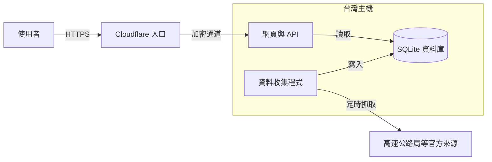
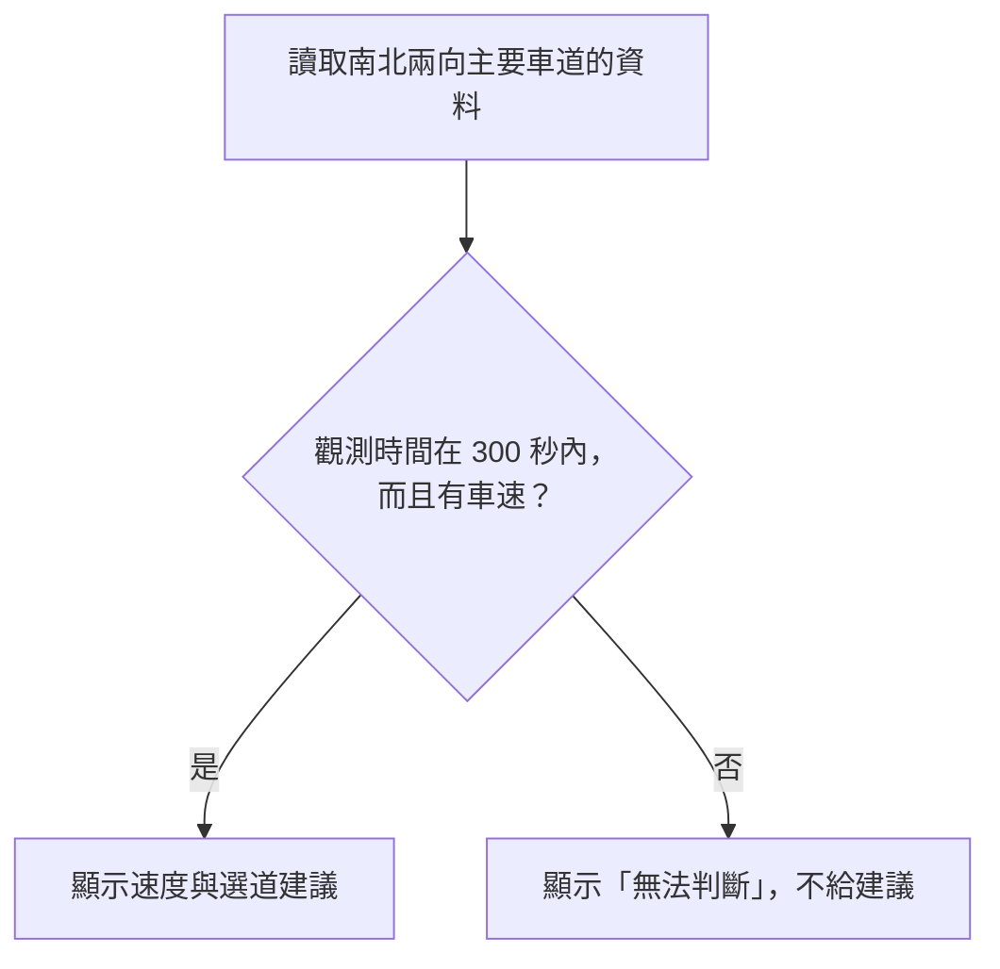
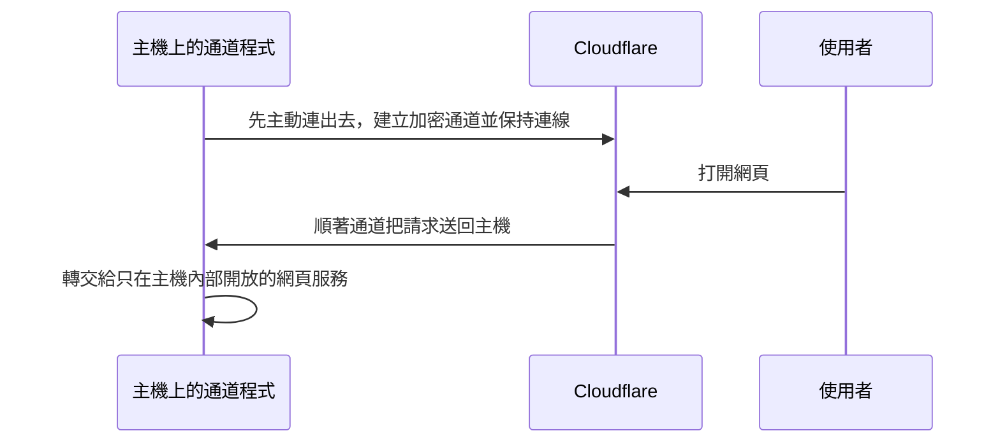
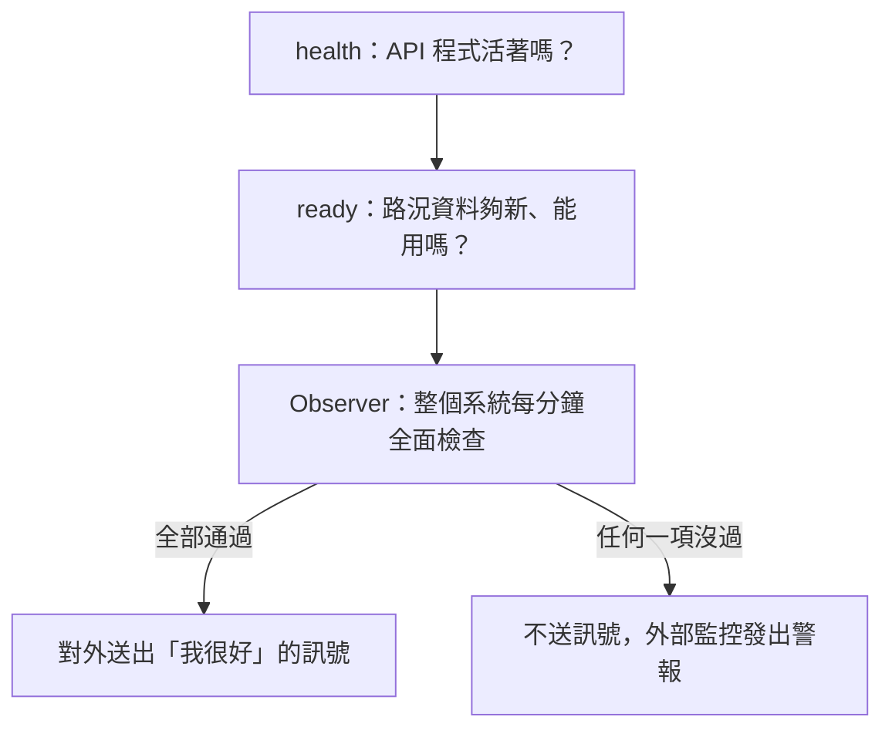
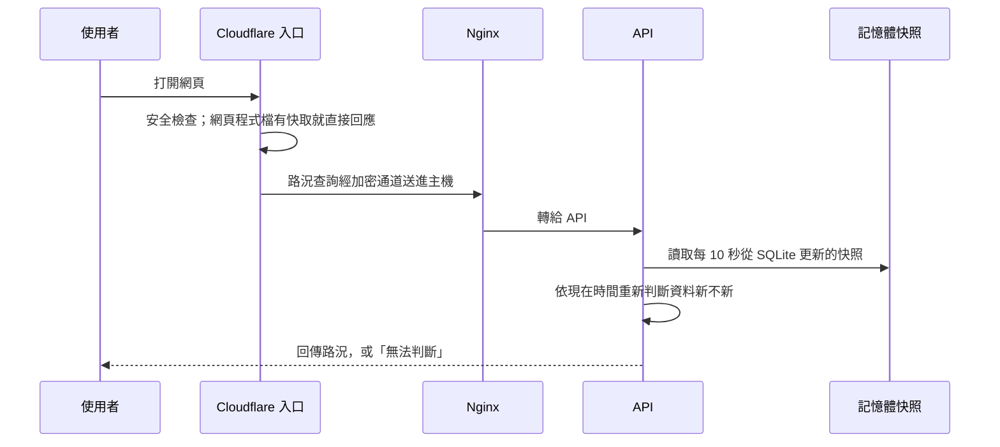
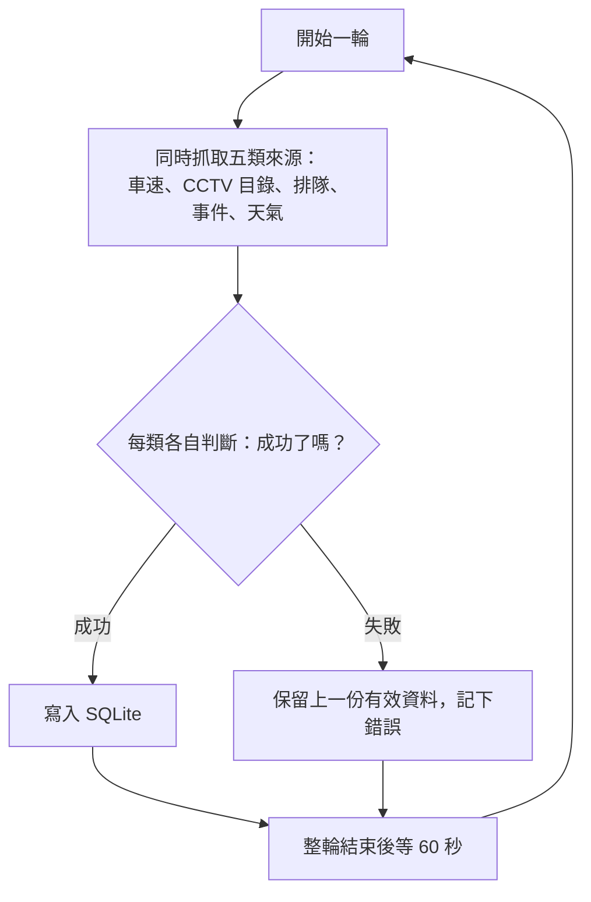
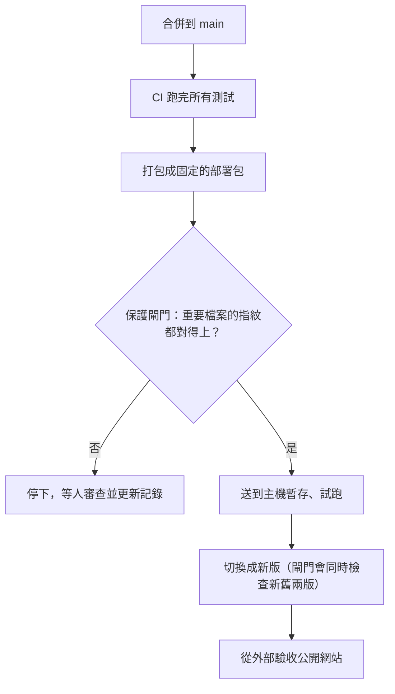

# 入隧前 · Tunnel Lookout

**在進雪山隧道前，比較內外車道的即時速度，幫用路人決定要走哪一條。**

[開啟入隧前](https://snow-tunnel-sentinel-edge.chiu-dev.workers.dev/) · 原始碼為私人 repo，這裡說明它是什麼、怎麼運作。

---

## 這是什麼

國道五號的雪山隧道全長約 13 公里，**隧道內禁止變換車道**。所以要走內側還是外側車道，只能在進隧道前決定一次。

官方其實有公開即時車速，但資料分散在不同地方、時間標示也不一致。用路人很容易誤判：把幾分鐘前的舊數字當成現在、看到另一個方向的資料，或把「抓不到資料」當成「道路暢通」。

入隧前把這些資料整理在一起，顯示：
- 同方向、同路段的內外車道速度與速差
- 每個數字是官方幾點幾分觀測的
- 沿線 CCTV 影像與事件資訊，讓使用者交叉確認

**資料不夠新的時候，它會直接說「無法判斷」，不給建議。**

## 系統全貌

整個系統跑在一台台灣的主機上，前面由 Cloudflare 負責對外的入口。主機上同時有兩條方向相反的路：

- **進來的路**：使用者打開網頁，請求經過 Cloudflare 和一條加密通道，進到主機上的網頁與 API，API 再從資料庫讀出路況。
- **出去的路**：主機上的資料收集程式（Collector）定時連到高速公路局，把官方資料抓回來存進資料庫。

兩條路只在資料庫交會。使用者從頭到尾不會直接碰到官方來源。

## 核心概念

### 1. 寧可說「無法判斷」，也不給錯的建議

路況資料舊了就是錯的。系統判斷資料新不新，看的是**官方記下的觀測時間**，不是「有沒有成功連上」。

例如，官方網頁顯示「剛更新」、連線也成功，但資料本身的觀測時間其實是半夜，系統一樣判定過期。另外，「沒有車經過」造成的速度 0 會被當成「沒有資料」，不會誤判成塞車。

### 2. 主機不開門，由裡往外連

主機上的服務都只讓「主機自己」連得到，對外的連接埠（80／443）全部關閉。外面的請求能進來，是因為主機上的通道程式**先主動往外連到 Cloudflare**，請求再順著這條通道送回來。

一般防火牆擋的是「外面主動連進來」，不擋「裡面主動連出去」，所以主機不用開任何對外的門也能提供服務。

### 3. 抓資料的程式只有一個，資料只有一個來源

資料只由一支 Collector 寫入一個 SQLite 資料庫。系統用一把鎖確保同一時間只有一份 Collector 在跑，避免重複寫入或對官方伺服器發出重複請求。網頁和 API 只讀不寫。

### 4. 「活著」和「能用」分開檢查

程式還在跑，不代表資料是新的。系統把「正常」分成三層，各自檢查：

Observer 採「全部正常才報平安」，而不是「出問題才發警報」：主機整台當機時，它根本送不出警報，但會自然停止報平安，外部一定會發現。

### 5. 部署全自動，但不能自己放行自己

程式合併後會自動測試、打包、部署。但主機上有一道**保護閘門**，記錄了 17 個重要檔案的指紋。這些檔案決定主機怎麼運作，只要有一個變了，部署就停下來，必須由人審查後親自更新記錄。部署流程不能自己幫自己開例外。

## 怎麼運作

### 一次查詢

網頁程式檔（JS、CSS）內容不會變，Cloudflare 可以快取；路況資料一直在變，**一律不快取**，每次都回主機拿最新的。

### 一輪資料收集

各類來源互不影響：排隊資料抓失敗，不會讓車速資料跟著失效。不常變動的資料（測站清單、CCTV 目錄）會快取 24 小時，天氣快取 15 分鐘，不必每輪重抓。

### 一次部署

任何一步沒過，流程就停下來，舊版繼續服務。

## 設計取捨

| 決定 | 換到什麼 | 代價 |
|---|---|---|
| 資料收集放在**台灣主機**，不用雲端函式 | 驗證後判斷官方資料需要台灣 IP，固定 IP 讓收集穩定 | 只有一台主機，壞了全部停；要自己管主機 |
| 資料不夠新就**不給建議** | 不會讓使用者拿舊資料做決定 | 官方資料延遲時，畫面常常沒有建議 |
| 保護閘門**寧可誤擋** | 部署流程無法改動主機的根本設定 | 改到無關緊要的內容也會被擋，要多一道人工手續 |

## 延伸閱讀

| 想知道 | 文件 |
|---|---|
| 請求怎麼走、Tunnel 與快取、對應網路分層 | [架構](docs/architecture.md) |
| health、ready、Observer 的細節 | [可靠性](docs/reliability.md) |
| systemd、備份、log 與權限設計 | [維運](docs/operations.md) |
| 自動部署流程與保護閘門 | [部署](docs/deployment.md) |
| 我負責什麼、AI 負責什麼 | [AI 協作](docs/ai-collaboration.md) |
| 還沒做到、沒驗證的事 | [限制](docs/limitations.md) |
| 開發時遇到的問題與處理 | [開發筆記](notes/) |

## 資料來源與授權

| 資料 | 提供者 | 授權 |
|---|---|---|
| [VD 靜態資訊](https://data.gov.tw/dataset/37661)、[VD 動態資訊](https://data.gov.tw/dataset/37662)、[CCTV 靜態資訊](https://data.gov.tw/dataset/37665) | 交通部高速公路局 | [政府資料開放授權條款－第1版](https://data.gov.tw/license) |
| 國道五號排隊與事件資訊 | 交通部高速公路局 [1968 網站](https://1968.freeway.gov.tw/) | 讀取網站頁面公開使用的資料，不是開放資料集，沒有另外標示授權條款 |
| 天氣 | [Open-Meteo](https://open-meteo.com/) | [CC BY 4.0](https://open-meteo.com/en/licence)；Weather data by Open-Meteo.com |

這個想法受到既有網站 [traffic.sentinelabs.io](https://traffic.sentinelabs.io/) 啟發。入隧前是獨立實作，沒有沿用對方的程式碼與設計，資料直接取自官方來源。

本 repo 的文章與圖表以 [CC BY 4.0](LICENSE) 釋出。資料來源各自依其授權條款使用，不在此授權範圍內。
