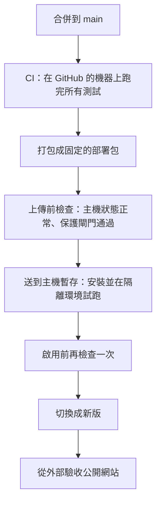
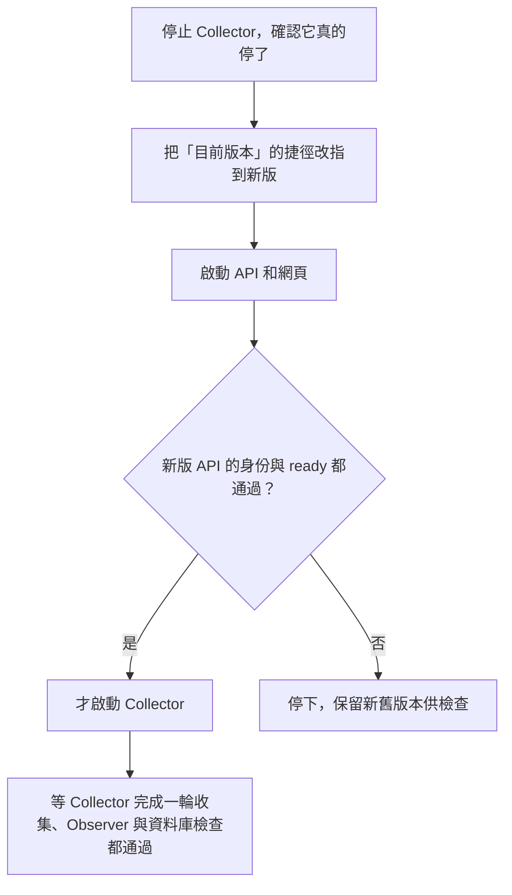

# 部署：全自動，但不能自己放行自己

[← 回到 README](../README.md)

這份文件說明程式從合併到上線經過哪些步驟、每一步由誰負責，以及保護閘門為什麼存在。

## 兩個分支：dev 和 main

- **dev**：平常的修改都先合進這裡。只跑測試，不部署。
- **main**：要發布時，把 dev 合進 main（或直接合進緊急修正），才會觸發自動部署。

這樣一般的修改可以頻繁合併，不會每合一次就動到正式環境。

## 從合併到上線

| 步驟 | 做什麼 | 失敗時 |
|---|---|---|
| CI | 型別檢查、單元測試，以及用 Chromium、WebKit 兩種瀏覽器跑完整的畫面測試 | 不產生部署包 |
| 打包 | 把通過測試的那一份程式固定成部署包，之後每一步都用同一包，不重新建置 | 不部署 |
| 上傳前檢查 | 確認主機上的服務、資料、備份都正常，受保護檔案的指紋也對得上 | 停下，不上傳 |
| 暫存 | 在主機上安裝套件，用不連外網的測試資料試跑 API、網頁與 Collector | 舊版繼續服務 |
| 切換 | 見下一節 | 依狀態處理，見〈失敗時怎麼辦〉 |
| 外部驗收 | 從外面打開公開網站，確認版本、網頁檔案、南北向路況、CCTV 都正確 | 標記為需要人處理 |

整條流程由 GitHub Actions 執行，不需要本機電腦開著，也不需要主機主動去 GitHub 抓程式。同一時間只會有一份部署在跑。

## 切換的那一刻

切換是最敏感的一步，因為新舊兩版要交接。順序是：

先停 Collector，是為了確保切換過程中不會有兩個版本同時寫資料庫。新版 API 確認沒問題後，才讓 Collector 重新開始抓資料。

切換前還會從雲端備份下載最新一份，實際做一次還原檢查。備份還原不回來，就不切換。

## 誰能做什麼

部署過程中用了幾個權限不同的身份，彼此不能越權：

| 身份 | 能做的事 | 不能做的事 |
|---|---|---|
| 部署用的 SSH 帳號 | 只能呼叫固定的幾個部署指令 | 不能執行任意指令 |
| 建置用的帳號 | 在隔離環境安裝套件、試跑新版 | 讀不到正式資料庫、密碼與備份 |
| root 管理程式 | 固定版本、切換服務 | 不執行新版程式碼本身 |

新版的程式碼絕不會用 root 執行。

## 保護閘門

主機上有一份只有 root 能改的設定檔，記錄 17 個重要檔案的指紋（sha256）。指紋是用檔案內容算出來的一串字，內容只要改一個字，指紋就完全不同。

| 類別 | 例子 |
|---|---|
| 套件與依賴 | `package.json`、`pnpm-lock.yaml` |
| 資料處理 | Collector 主程式、資料庫存取 |
| 服務設定 | 五個 systemd 設定檔 |
| 維運程式 | Observer、備份程式 |

部署包裡這些檔案的指紋，只要有一個跟主機的記錄不同，部署就停下來。這些檔案一改，影響的是主機本身，所以變更要由人審查，主機上的記錄由管理員用 root 更新。**部署流程不能自己幫自己開例外**，否則任何一個合併進 main 的修改，都能改動主機的根本設定。

切換時閘門會同時檢查正在跑的舊版與要換上的新版，所以更新記錄時，新舊兩版都要對得上。

實際被擋下一次的經過，見開發筆記〈[部署被保護閘門誤擋](../notes/2026-09-19-deploy-gate.md)〉。

## 失敗時怎麼辦

| 狀態 | 意思 |
|---|---|
| 已驗證 | 主機檢查與外部驗收都通過 |
| 暫存失敗 | 在暫存或試跑階段就失敗，正式服務沒有被切換 |
| 已退回 | 新版 Collector 還沒啟動前發現問題，自動退回舊版。不會動到資料庫 |
| 需要人處理 | 新版 Collector 已經啟動過，不做自動退回；保留新舊版本與狀態，依維運手冊處理 |

只要不是「已驗證」，就不能宣稱部署完成。

---

查核依據：私人 repo `deploy/cd/README.md`、`docs/RELEASE.md`、`deploy/cd/artifact.py` 的保護清單（2026-10-22，dev `a30d531`）。本文依 repo 文件整理，不代表某一次部署的實際結果。
