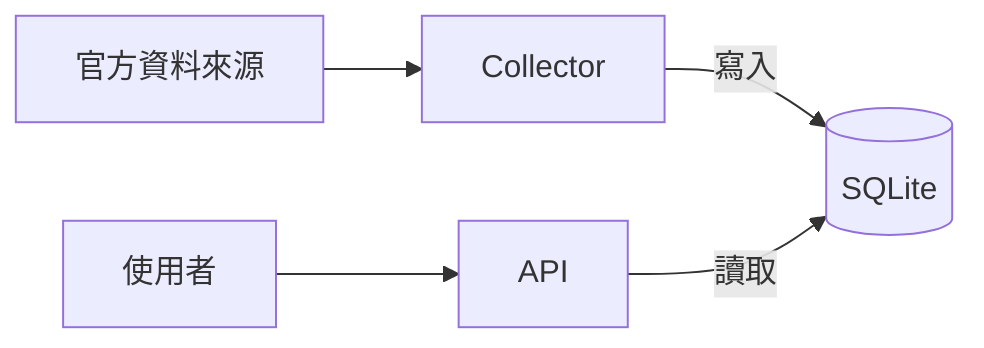

# 可靠性：活著不等於能用

[← 回到 README](../README.md)

這份文件說明系統怎麼判斷「正常」：health、ready、Observer 各自檢查什麼，以及資料新鮮度怎麼判斷。

## 「正常」有三層

說一個服務「正常」，至少可以指三件不同的事，由下往上：

| 層 | 壞掉時會怎樣 | 怎麼發現 |
|---|---|---|
| 主機 | 上面所有程式一起停 | 外部監控收不到定時回報（見下方 Observer） |
| API 程式 | 主機還在，但 API 這支程式掛了 | `/api/health` 失敗；systemd 會自動重啟它 |
| 資料 | 程式都活著，但資料已經舊了 | `/api/ready` 回 503 |

主機掛掉，API 一定跟著掛；但反過來不成立。最容易被忽略的是第三層：**程式活著，資料卻是舊的。**

## Collector 和 API 是兩支獨立的程式

抓資料的 Collector 和回應使用者的 API 是兩支獨立的程式，各自由 systemd 管理，只透過 SQLite 交換資料。所以 Collector 停了，API 照樣活著，`/api/health` 照樣回 200，因為它只代表 API 這支程式還在回應。

## health 和 ready 檢查的是不同的事

| | `/api/health` | `/api/ready` |
|---|---|---|
| 回答的問題 | API 程式活著嗎？ | 路況資料能拿來做判斷嗎？ |
| 怎麼判斷 | 程式有回應就算通過 | 用「現在時間 − 資料的觀測時間」，南北兩個方向的主要車道都要在 300 秒內，而且車速不是空的 |
| 失敗時 | 沒有回應 | 回 HTTP 503，系統也停止給選道建議 |

**例子**：Collector 停了 10 分鐘。API 還活著，health 回 200，畫面也還看得到最後一筆速度。但這筆資料已經超過 300 秒，所以 ready 回 503，入隧前不會拿它來建議車道。只看 health 的話，會以為一切正常，使用者卻拿著 10 分鐘前的速度在選車道。

## 資料變舊有兩種原因

1. **我們這邊**：Collector 停了，沒有去抓。
2. **官方那邊**：Collector 有去抓，但官方資料本身就沒更新。那不是我們的伺服器，我們無法控制。

ready 不管是哪一種原因，只看資料裡官方記下的觀測時間。所以兩種情況都會被發現。資料舊了，責任可能在對方，但發現它是我們的責任。

### 真實案例：連線成功，資料卻是舊的

專案文件記錄了 2026-09-07 中午 12:25 抓國五排隊資料時的情況：
- 連線成功，HTTP 200。
- 官方網頁上的「最後更新」，顯示的其實是瀏覽器的現在時間。
- 資料本身的觀測時間 `jam_time`，卻是當天半夜 00:39，已經舊了快 12 小時。

HTTP 200 只代表「東西有送到」，不代表內容是新的。所以入隧前一律以資料本身的觀測時間判斷，不看連線有沒有成功，也不看網頁上的「最後更新」。

## Observer：沒有消息就是壞消息

主機上有一個 Observer 每分鐘執行一次，檢查各個服務、health、ready、最近一輪資料收集、磁碟、備份與版本身份。**全部通過**，才送一個「我很好」的訊號（heartbeat）給外部監控服務；任何一項沒過，就不送。外部監控一段時間沒收到訊號，就會發出警報。

為什麼不反過來，出問題時才發警報？因為主機整台當機時，它連「我出問題了」都送不出去。改成定時回報，當機時自然就停止回報，外部一定會發現。最嚴重的故障，反而最容易被發現。

---

查核依據：私人 repo `README.md`、`docs/DATA.md`、`docs/PRODUCTION.md`（2026-10-21，dev `a30d531`）。本文依文件整理，不是在主機上實際觀察的結果。
